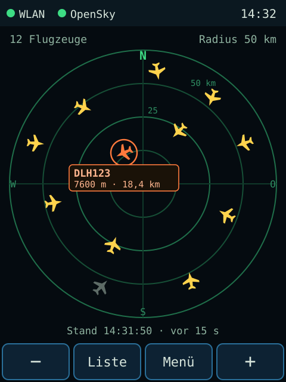
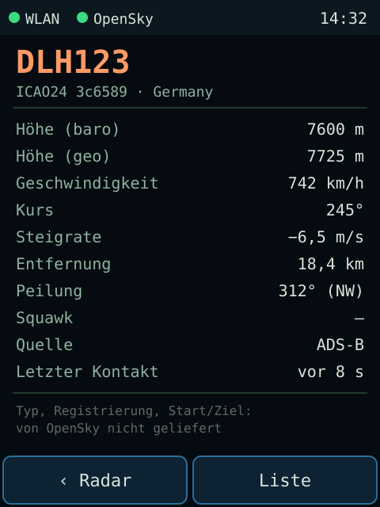
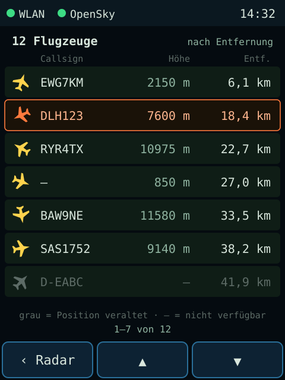

# HomeFlightTracker

Eigenständiges Tisch- und Wandgerät, das Flugbewegungen rund um einen frei wählbaren Standort als Radar auf einem 2,4-Zoll-Touchdisplay anzeigt. Die Positionsdaten stammen vom [OpenSky Network](https://opensky-network.org).

<p align="center">
  
  
  
</p>
<p align="center"><sub>Mockups der geplanten Oberfläche (240 × 320 px, Beispieldaten). Weitere Entwürfe: <a href="docs/ui.md">docs/ui.md</a></sub></p>

> **Projektstatus:** in Entwicklung. M1 und M2 sind abgenommen; OpenSky-Abruf (M3) und Radar-Oberfläche (M4) sind umgesetzt und im Test, siehe [Roadmap](#roadmap).

## Bedienung

| Bildschirm | Bedienung |
|---|---|
| Radar | Flugzeug antippen = auswählen (Kurzinfo); Kurzinfo oder erneutes Antippen = Details; überlappende Symbole: erneut antippen wechselt zum nächsten. **+** / **−** = hinein-/herauszoomen (10/25/50/100/250 km) |
| Details | Werte aus OpenSky mit Einheiten; „–“ = nicht verfügbar |
| Liste | nach Entfernung sortiert, Zeile antippen = Details, blättern mit Zurück/Weiter |
| Menü | WLAN, IP-Adresse, Standort, OpenSky-Status, letzter Abruf, Credits; Setup, Kalibrierung, Diagnose |

## Funktionen (Ziel des MVP)

- **Radar** mit Norden oben, Entfernungsringen und einstellbarer Reichweite (10, 25, 50, 100 oder 250 km). Die Symbole zeigen in Bewegungsrichtung und unterscheiden Verkehrsflugzeug, Kleinflugzeug und Hubschrauber.
- **Antippen** eines Flugzeugs öffnet die Details: Callsign, ICAO24, Herkunftsland, Höhe, Geschwindigkeit, Kurs, Steigrate, Entfernung, letzter Kontakt.
- **Flugliste**, sortiert nach Entfernung.
- **Einrichtung ohne PC:** geschützter Setup-Access-Point mit Captive Portal für WLAN, Standort (Ortsname oder Koordinaten), OpenSky-Zugang, Reichweite und Abrufintervall.
- **Ehrliche Datenanzeige:**
  - Alter und Stand der Daten sind immer sichtbar.
  - Veraltete Positionen werden gekennzeichnet.
  - Es gibt keine erfundenen Angaben zu Flugzeugtyp, Registrierung, Start oder Ziel.
- **Stromsparend:** Display dimmt und schaltet sich ab, nachts Tiefschlaf mit Wecken per Berührung.
- **Kontingentschonend:** Ein Abruf kostet 1 OpenSky-Credit. Mit dem Standardintervall von 60 s sind das ca. 1 440 der 4 000 Tages-Credits.

## Hardware

| Komponente | Ausführung |
|---|---|
| Trägerplatine und Gehäuse | AZ-Touch MOD, Platinenrevision V01-03 (Zihatec) |
| Mikrocontroller | ESP32 DevKit C mit ESP32-WROOM-32 (4 MB Flash, kein PSRAM) |
| Display | 2,4″ TFT, 240 × 320, ILI9341 (SPI) |
| Touch | resistiv, XPT2046 (SPI, gemeinsamer Bus mit dem Display) |
| Versorgung | über die Klemme der Platine (Spannungsregler) oder USB am DevKit |

Pinbelegung mit Quellen und Prüfstatus: **[docs/hardware.md](docs/hardware.md)**

## Schnellstart

1. Arduino IDE mit dem Boardpaket **esp32 von Espressif (3.3.8)** einrichten.
2. Bibliotheken **TFT_eSPI 2.5.43** und **ArduinoJson 7.4.3** über den Bibliotheksverwalter installieren.
3. `HomeFlightTracker/HomeFlightTracker.ino` öffnen, Board **ESP32 Dev Module** und Partitionsschema **Minimal SPIFFS** wählen.
4. Hochladen und den seriellen Monitor mit 115200 Baud öffnen.

Die Bibliothek TFT_eSPI muss **nicht** verändert werden: Die Pin-Konfiguration liegt als `tft_setup.h` im Sketch-Ordner.

Danach richtet man das Gerät per Smartphone ein: Es startet einen geschützten Setup-Access-Point, Passwort und Adresse stehen auf dem Display. Die ausführliche Anleitung inklusive Werksreset steht in **[docs/setup.md](docs/setup.md)**.

## Verzeichnisstruktur

```text
HomeFlightTracker/
├── HomeFlightTracker/            Arduino-Sketch-Ordner (in der IDE öffnen)
│   ├── HomeFlightTracker.ino     Einstiegspunkt
│   ├── tft_setup.h               TFT_eSPI-Konfiguration für AZ-Touch MOD
│   └── src/                      Module (von der Arduino IDE automatisch mitkompiliert)
│       ├── app/                  Ablaufsteuerung, Betriebsarten
│       ├── board/                feste Pinbelegung der Trägerplatine
│       ├── config/               dauerhafte Einstellungen (NVS)
│       ├── diag/                 Heap- und Ressourcenmessung
│       ├── geo/                  Distanz, Peilung, Bounding Box
│       ├── hwtest/               Diagnosemodus (Hardwaretest)
│       ├── model/                Flugzeugdaten (Tabelle fester Größe), Einheiten
│       ├── net/                  WLAN, NTP, Setup-Portal, Weboberfläche
│       ├── opensky/              OAuth2, Abruf, Streaming-Parser, Kontingent, Hintergrund-Task
│       └── ui/                   Radar, Bedienelemente, Text mit Umlauten, Touch
├── docs/                         Projektdokumentation
│   └── mockups/                  Oberflächenentwürfe (SVG)
├── tests/host/                   Unit-Tests für den Entwicklungsrechner
├── tools/                        Hilfsskripte (z. B. Erzeugung der Flugzeugsymbole)
├── CHANGELOG.md
└── README.md
```

Die geplante Struktur der späteren Module steht in [docs/architecture.md](docs/architecture.md).

## Dokumentation

| Dokument | Inhalt |
|---|---|
| [docs/hardware.md](docs/hardware.md) | Pin-Matrix, Stromversorgung, Strapping-Pins, Quellen |
| [docs/setup.md](docs/setup.md) | Entwicklungsumgebung, Bibliotheken, Board-Einstellungen, Flashen, Recovery |
| [docs/architecture.md](docs/architecture.md) | Module, Tasks, Datenfluss, Entscheidungen |
| [docs/opensky.md](docs/opensky.md) | API, Authentifizierung, Kontingente, Nutzungsbedingungen |
| [docs/testing.md](docs/testing.md) | Testverfahren und Abnahmeprotokolle |
| [docs/ui.md](docs/ui.md) | Bedienkonzept und Mockups |
| [CHANGELOG.md](CHANGELOG.md) | Änderungshistorie |

## Roadmap

| Meilenstein | Inhalt | Status |
|---|---|---|
| M0 | Projektgerüst, Dokumentation, Pin-Matrix | ✅ erledigt |
| M1 | Hardware-Machbarkeit: Display, Rotation, Backlight, Touch-Kalibrierung, Heap-Basiswerte | ✅ abgenommen |
| M2 | Konfiguration und WLAN-Provisioning (Setup-AP, Captive Portal, Web-UI, Werksreset) | ✅ abgenommen |
| M3 | OpenSky-Client (NTP, TLS, OAuth2, Bounding Box, JSON, Kontingent, Backoff) | 🧪 umgesetzt, Test auf Hardware läuft |
| M4 | Radar-Oberfläche (Symbole, Details, Liste, Reichweite, Status) | 🧪 umgesetzt, Test mit Flugverkehr ausstehend |
| Energie | Dimmen, Display aus, Nachtruhe mit Tiefschlaf | 🧪 umgesetzt, noch nicht auf dem Gerät getestet |
| M5 | Robustheit (Geocoding, mDNS, Watchdog, Langzeittest, Review, Release) | geplant |

Bewusst **nicht** Teil des MVP sind: ADS-B-Empfänger, Abflug- und Ankunftstafeln, Routen- oder Zielermittlung, Cloud-Konto, Kartenkacheln, Push-Benachrichtigungen und Audio.

## Datenquelle und Attribution

Die Flugpositionen stammen vom **OpenSky Network** (<https://opensky-network.org>). Die Nutzung unterliegt den [Nutzungsbedingungen von OpenSky](https://opensky-network.org/about/terms-of-use). Die REST-API ist für nicht-kommerzielle Zwecke vorgesehen. Details und offene Prüfpunkte stehen in [docs/opensky.md](docs/opensky.md).

> Matthias Schäfer, Martin Strohmeier, Vincent Lenders, Ivan Martinovic und Matthias Wilhelm:
> „Bringing Up OpenSky: A Large-scale ADS-B Sensor Network for Research“.
> In: *Proceedings of the 13th IEEE/ACM International Symposium on Information Processing in Sensor Networks (IPSN)*, Seiten 83–94, April 2014.

## Sicherheit

- Es werden keine Zugangsdaten im Repository gespeichert. Konfigurationsbeispiele enthalten nur Platzhalter.
- Einstellungen und Zugangsdaten liegen im NVS des ESP32. Ohne aktivierte Flash-Verschlüsselung sind sie **nicht verschlüsselt** und mit physischem Zugriff auf das Gerät auslesbar.
- Der Setup-Access-Point ist WPA2-geschützt. Das Passwort wird bei jedem Setup-Start zufällig erzeugt und nur am Display angezeigt. Nach 15 Minuten endet der Setup-Modus.
- Die Weboberfläche im Heimnetz verlangt eine HTTP-Digest-Anmeldung. Die Verbindung ist jedoch **unverschlüsseltes HTTP**: Neu eingegebene Geheimnisse werden im Heimnetz im Klartext übertragen.
- Gespeicherte Geheimnisse werden nie an den Browser zurückgegeben und nie geloggt.
- Ein Werksreset ist nur lokal am Gerät möglich.

## Lizenz

Der Quellcode steht unter der [MIT-Lizenz](LICENSE), © 2026 Kai Linde.

Die Lizenz gilt nur für den Code dieses Projekts. Für die Flugdaten gelten die Nutzungsbedingungen des OpenSky Network. Die verwendeten Bibliotheken haben eigene Lizenzen: TFT_eSPI (MIT/BSD), ArduinoJson (MIT), ESP32-Arduino-Core (LGPL-2.1).
