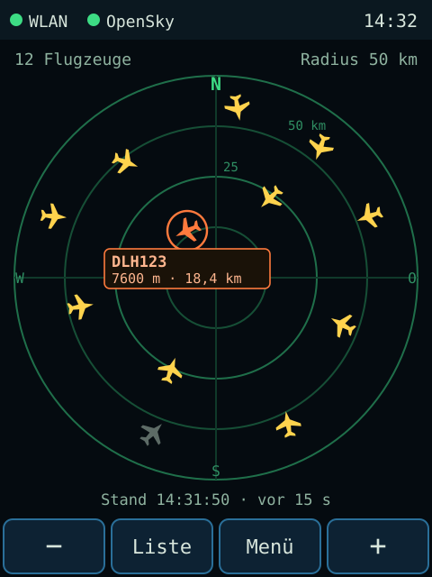
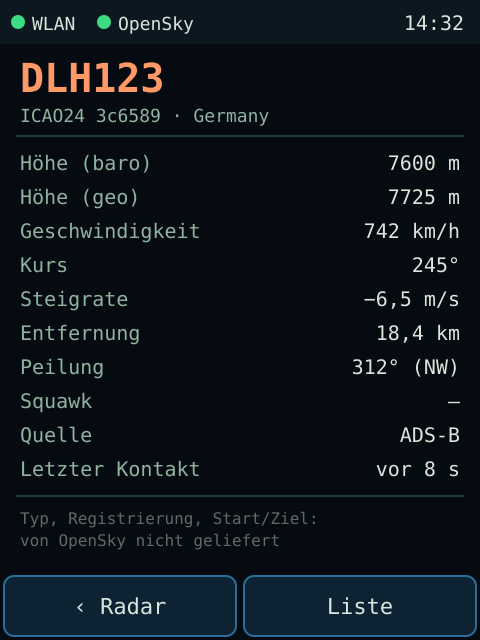
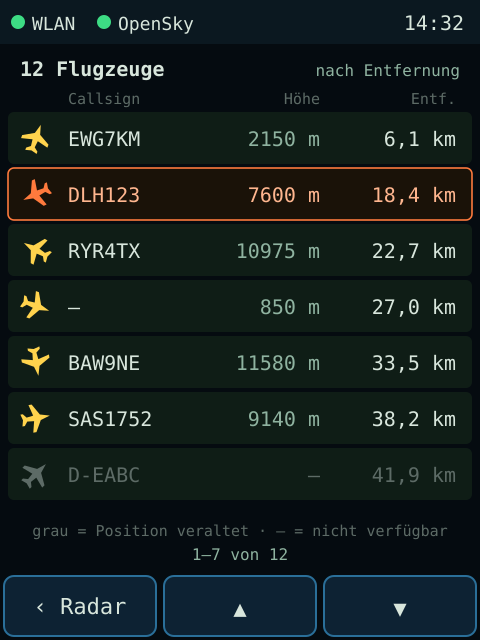
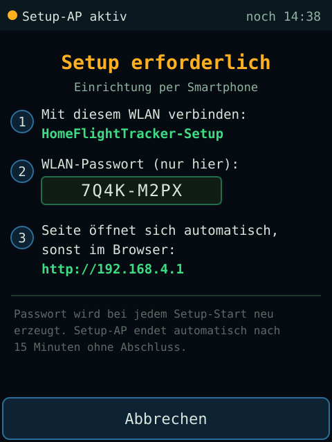
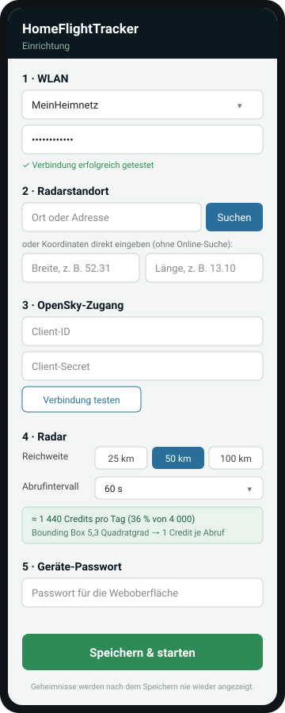

# Bedienkonzept und Mockups

Die Mockups zeigen den geplanten Zielzustand (M2/M4) im Maßstab 1:1 zur Displayauflösung (240 × 320 px, Hochformat). Alle Flugdaten darin sind **Beispieldaten**.

## Gerät

| Radar | Details | Liste | Setup erforderlich |
|---|---|---|---|
|  |  |  |  |

### Radar

- **Statusleiste:** WLAN- und OpenSky-Status (grün = ok, gelb = eingeschränkt, rot = Fehler) und Uhrzeit. Darunter stehen die Anzahl der Flugzeuge und der Radius.
- **Radar:** Norden oben, vier Entfernungsringe, Standortkreuz in der Mitte. Die Symbole zeigen in Richtung von `true_track`.
- **Auswahl:** Antippen markiert ein Flugzeug (orange) und blendet eine Kurzinfo ein. Ein zweites Antippen öffnet die Details. Liegen Symbole übereinander, wird das nächstgelegene im Trefferradius gewählt; erneutes Antippen wechselt zum nächsten Kandidaten.
- **Veraltete Positionen** werden grau und ohne Bewegung dargestellt und nach einer festgelegten Zeit ausgeblendet.
- **Aktualität:** „Stand hh:mm:ss · vor n s“ ist immer sichtbar.
- **Bedienleiste:** Reichweite − / + (10, 25, 50, 100, 250 km), Liste, Menü. Jede Schaltfläche ist mindestens 56 × 30 px groß.

### Details

Es werden nur Werte aus dem OpenSky-State-Vektor angezeigt, mit eindeutigen Einheiten. Fehlende Werte erscheinen als „–“. Ein fester Hinweis stellt klar, dass Typ, Registrierung und Start/Ziel nicht geliefert werden.

Die Details haben zwei Seiten, umgeschaltet mit der dritten Schaltfläche („Fuß“ bzw. „Meter“); oben rechts steht, welche Einheiten gerade gelten. Die gewählte Seite bleibt bis zum Neustart für alle Flugzeuge erhalten.

| Wert | Seite 1 (metrisch) | Seite 2 (Luftfahrt) |
|---|---|---|
| Höhe (baro), Höhe (geo) | m | ft |
| Flugfläche | – | FL aus der barometrischen Höhe (Hunderte Fuß, Standarddruck 1013,25 hPa) |
| Geschwindigkeit | km/h | kt |
| Steigrate | m/s | ft/min |
| Entfernung | km | NM |
| Kurs, Peilung, Squawk, Letzter Kontakt | gleich | gleich |
| Quelle (ADS-B, MLAT …) | ja | – |

Unter der Tabelle steht auf beiden Seiten die Kategorie im Klartext (z. B. „Hubschrauber“, „Schwer (>136 t)“, ohne Angabe „k. A.“).

### Liste

Die Liste ist nach Entfernung sortiert und zeigt sieben Zeilen pro Seite, die mit ▲ / ▼ geblättert werden. Antippen einer Zeile öffnet die Details.

### Setup erforderlich

- Das Gerät zeigt SSID, ein **pro Setup-Start neu erzeugtes WLAN-Passwort** und die Fallback-Adresse an.
- Der Setup-AP beendet sich automatisch nach einer Zeitspanne ohne Abschluss. Ein dauerhaft offenes Konfigurations-WLAN gibt es nicht.

## Einrichtungsportal (Smartphone)

Das Portal ist in fünf Schritte gegliedert: WLAN, Standort (Suche oder Koordinaten), OpenSky-Zugang, Radar und Geräte-Passwort.

- Den Tagesverbrauch an Credits rechnet das Portal live aus der Reichweite und dem Intervall aus.
- Geheimnisse werden nach dem Speichern nie wieder angezeigt.

## Umsetzungsstand (M4)

- **Radar, Details, Liste** wie in den Mockups. Das frühere Statusbild ist jetzt das **Menü**: WLAN, IP-Adresse, Standort, OpenSky-Status, letzter Abruf, Credits und die Schaltflächen Radar, Profil, Setup und Mehr. „Mehr“ ersetzt die Leiste durch Zurück, Kalibr. und Diag., damit jede Schaltfläche groß genug bleibt.
- **Zoom:** **+** = hineinzoomen (kleinerer Radius), **−** = herauszoomen. Ein größerer Radius wird erst beim nächsten regulären Abruf mit Daten gefüllt; der Hinweis erscheint in der Fußzeile. Die Reichweite wird gespeichert.
- **Kurzinfo:** Ohne Auswahl trägt automatisch das nächstgelegene Flugzeug im Radius eine neutrale Kurzinfo (Callsign, Höhe bzw. „am Boden“, Entfernung). Ein ausgewähltes Flugzeug wird orange hervorgehoben und trägt die Kurzinfo stattdessen. Antippen einer Kurzinfo öffnet die Details.
- **Auswahl:**
  - Antippen wählt das nächstgelegene Symbol im Umkreis von 20 px; Antippen einer leeren Stelle hebt die Auswahl auf.
  - Bei Überlappung wechselt erneutes Antippen zum nächsten Kandidaten.
  - Ist nur ein Kandidat vorhanden und bereits ausgewählt, öffnen sich die Details. Das gilt auch beim Antippen der Kurzinfo.
- **Flugzeugsymbol:** 17 × 17 px, vorgedreht in 24 Richtungen (15°-Schritte) mit Kantenglättung (2 Bit Deckung, Randpixel mit dem Hintergrund gemischt). Die Bitmaps erzeugt `tools/gen_icons.py` aus Vektor-Silhouetten; das Gerät dreht nicht selbst. Die Form richtet sich nach der ADS-B-Kategorie (`src/model/AircraftCategory.h`):
  - **Hubschrauber** (Rumpf, Heckausleger, Rotorkreis): Kategorie 8
  - **Kleinflugzeug** (gerade Flügel, Propeller): Leichtflugzeug (2), Segelflugzeug (9), Ultraleicht (12)
  - **Verkehrsflugzeug** (Pfeilflügel): alle übrigen und Flugzeuge ohne Kategorie. Viele Transponder senden keine Kategorie. Flugzeuge am Boden: blaugrau, Kurzinfo „am Boden“ statt Höhe.
- **Ringbeschriftung:** Nur der halbe Radius ist am Ring beschriftet; der volle Radius steht oben rechts.
- **Abweichungen vom Mockup:**
  - Statt Pfeiltasten heißen die Schaltflächen der Liste „Zurück“ und „Weiter“.
  - Die Ortssuche im Portal folgt in M5.
- **Profile:** Menü → Profil zeigt bis zu 5 Profile (Name, WLAN · Ort), das aktive orange hinterlegt. Antippen eines anderen Profils fragt „Profil wechseln?“ mit Ja/Nein; Ja übernimmt WLAN und Standort und startet neu. Ein unzulässiges Profil (z. B. Kontingent am anderen Standort) wird mit Grund abgelehnt. Neue Profile entstehen in der Weboberfläche.
- **Energie:** Gedimmtes oder dunkles Display wird durch die erste Berührung nur geweckt. In der Nachtruhe zeigt die Fußzeile „Nachtruhe · Tiefschlaf in … s“; das Menü zeigt das Zeitfenster.
- **Ausrichtung:** Die Oberfläche ist für das Hochformat (Rotation 0) ausgelegt.

## Gestaltungsregeln

- Dunkles, sachliches Aviation-Design. Lesbarkeit und Performance haben Vorrang vor Effekten.
- Farben: Hintergrund `#050B10`, Radarringe `#1F6F4A`, Flugzeuge `#FFD34D`, Auswahl `#FF7A3D`, Text `#D8E6DC`, gedämpfter Text `#8FB3A0`, veraltet `#5D6B66`.
- **Schriften:** Die eingebauten Fonts von TFT_eSPI enthalten keine Umlaute. Für Font 2 (16 px) zeichnet `ui::drawText` ä/ö/ü/Ä/Ö/Ü als Grundbuchstabe mit zwei Punkten, ß als „ss“ und ° über das Gradzeichen des Fonts. Große Überschriften (Font 4) verwenden nur Text ohne Umlaute. Diagnose- und Startbildschirm umschreiben Umlaute noch.
